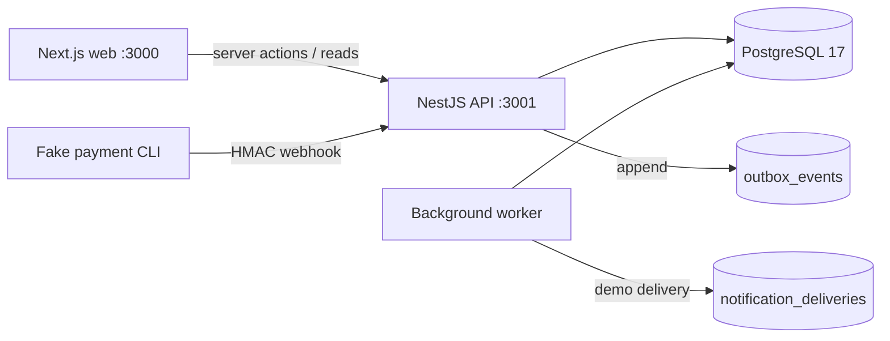

# Mentor Booking

A full-stack, credit-based mentor scheduling system built with NestJS, Next.js, TypeScript, and PostgreSQL. It demonstrates the parts of booking systems that are easy to get wrong: concurrent spending and booking, timezone/DST conversion, immutable accounting, webhook recovery, and retry-safe background work.

## What is included

- Mentees browse mentors, view slots in their own timezone, buy credits, book and cancel sessions, and inspect wallet/session history.
- Mentors manage recurring local-time availability and absolute-time blockouts, see sessions, record attendance, and cancel with an automatic refund.
- Admins search users, inspect ledgers, and grant or revoke credits with a required reason and idempotency key.
- A separate worker starts and resolves sessions, grants no-show rollover credits, expires rollover lots, queues reminders, and dispatches an outbox.
- A fake signed payment provider supports success/refund delivery, duplicates, out-of-order events, crash recovery, reversals, and debt.

## Architecture at a glance



PostgreSQL is the coordination boundary. Transactions, row locks, exclusion constraints, unique idempotency keys, an append-only ledger, and a durable webhook inbox enforce correctness independently of UI state. See [Design and architecture](docs/design.md), the [ERD](docs/erd.md), and [system test evidence](docs/system-tests.md).

## Technology stack

| Layer | Delivered version |
|---|---|
| API | NestJS 11.2.8, Node.js, TypeScript 5.9.3, `pg` 8.23.1 |
| Web | Next.js 16.4.5, React 19.3.1, Tailwind CSS 4 |
| Time handling | Luxon 3.7.2 with IANA timezone data |
| Database | PostgreSQL 17 (17.11 in the latest recorded verification) |
| Browser tests | Playwright 1.65.0, Chromium |
| Runtime | Docker Compose; API, web, worker, migrations, and database services |

## Prerequisites

- Docker Desktop or another Docker engine with Compose v2
- Ports `3000` and `3001` available
- Optional for host-side checks: Node.js 24 and npm 11

No local PostgreSQL installation is needed.

## Quick start

From the repository root:

```sh
docker compose up --build -d --wait
docker compose exec -T api node infra/db/bootstrap.mjs seed
```

The first command creates local secrets, starts PostgreSQL, applies migrations, then starts the API, worker, and web app. The seed command is safe to repeat. `npm run seed` is equivalent when npm is installed.

Open the web application at <http://localhost:3000> and the health endpoint at <http://localhost:3001/health>. The home page is a demo account picker; no password is used.

To stop while preserving the database, run `docker compose down`. Do not add `-v` unless you intentionally want to delete the database and generated secrets.

## Seed accounts

All personas are fictional and use fixed UUIDs.

| Name | Role | Timezone | UUID |
|---|---|---|---|
| Amelia Reed | mentor | Europe/London | `00000000-0000-4000-8000-000000000001` |
| Ravi Sen | mentor | Asia/Kolkata | `00000000-0000-4000-8000-000000000002` |
| Alex Chen | mentee | America/Vancouver | `00000000-0000-4000-8000-000000000003` |
| Sam Rivera | mentee | America/New_York | `00000000-0000-4000-8000-000000000004` |
| Demo Admin | admin | UTC | `00000000-0000-4000-8000-000000000005` |
| Maya Okafor | mentor | Africa/Lagos | `00000000-0000-4000-8000-000000000006` |
| Lucas Martins | mentor | America/Sao_Paulo | `00000000-0000-4000-8000-000000000007` |
| Hana Sato | mentor | Asia/Tokyo | `00000000-0000-4000-8000-000000000008` |

For direct API calls, pass a seeded UUID as `X-User-Id`:

```sh
curl -H "X-User-Id: 00000000-0000-4000-8000-000000000003" http://localhost:3001/me
```

## Main UI routes

| Persona | Routes |
|---|---|
| Mentee | `/mentors`, `/sessions`, `/wallet`, `/wallet/history` |
| Mentor | `/mentor`, `/mentor/sessions`, `/mentor/availability` |
| Admin | `/admin`, `/admin/users`, `/admin/adjustments`, `/admin/ledger` |

## Configuration

Compose works with no manual secrets. Copy `.env.example` to `.env` only when overriding defaults. `DEMO_AUTH_ENABLED=true` enables seeded-ID authentication. Database URLs, `WEBHOOK_SECRET`, and worker poll/batch settings can also be overridden. The API uses a restricted database login; migrations use a separate privileged connection, and the webhook key is not exposed to the browser.

## Payment demo

The MVP offers one four-credit pack. Create an order in the mentee wallet UI, copy its provider payment ID, then simulate a signed event:

```sh
npm run payment:simulate -- --payment fake_payment_id_from_ui --event succeeded
```

Refresh the wallet to see the single grant. Other useful commands are:

```sh
npm run payment:simulate -- --payment fake_payment_id_from_ui --event refunded
npm run payment:recover
npm run worker:once
npm run credits:expire
```

Repeated success cannot grant twice. Refund-before-success is terminal. Refund-after-spend reverses the unused portion and records the consumed portion as debt. Verified webhook bytes are stored before financial processing, so redelivery or `payment:recover` can resume after a crash.

## Tests and quality checks

```sh
npm ci
npx playwright install chromium
npm run lint
npm run typecheck
npm run build
npm test
```

With the Compose stack running, execute real PostgreSQL integration tests and Chromium E2E tests:

```sh
npm run test:integration
npm run test:e2e
```

Individual suites are available as `npm run test:bookings`, `test:availability`, `test:cancellations`, `test:payments`, `test:wallet`, `test:lifecycle`, and `test:worker`. Booking/credit concurrency is in `test:bookings`; London DST and cross-date timezone cases are in `test:availability` and unit tests.

Integration suites create isolated temporary databases and include real concurrent requests for the same slot/last credit, payment replay and recovery, booking/cancellation races, lifecycle workers, and DST boundaries. E2E covers directory browsing, book → cancel → refunded wallet, and worker-driven outcomes. Detailed commands and verified counts are in [docs/system-tests.md](docs/system-tests.md).

## API overview

| Area | Endpoints |
|---|---|
| Identity | `GET /me` |
| Directory and slots | `GET /mentors`, `GET /mentors/:id`, `GET /mentors/:id/slots` |
| Booking | `POST /sessions`, `GET /sessions/me`, cancellation preview/cancel, join |
| Wallet | `GET /wallet/me`, `GET /wallet/me/transactions` |
| Payments | `POST /payments/purchases`, `POST /webhooks/fake-payments` |
| Mentor | availability, blockouts, sessions, attendance, cancellation |
| Admin | user search, ledger inspection, credit adjustment |

The scheduling contract and examples are in [docs/mentor-schedule.openapi.json](docs/mentor-schedule.openapi.json).

## Key business rules

- Sessions are one 30-minute slot costing one credit.
- Weekly availability is stored as mentor-local weekday/time; sessions and blockouts are stored as UTC instants (`timestamptz`).
- Rollover credit is spent before normal credit, earliest expiry first.
- A mentee cancellation refunds only when it occurs strictly more than 24 hours before start. Exactly 24 hours receives no refund. Cancellation is closed at session start.
- A mentor cancellation refunds the original allocation. A mentor no-show grants one rollover credit expiring 30 elapsed days after resolution.
- Wallet balance is derived from immutable ledger entries; corrections are compensating entries, never edits.

## Security model

Authentication is deliberately fake for the assignment. The web app stores a seeded user ID in an HTTP-only cookie and its server forwards that identity to the API. The API reloads the user and role from PostgreSQL and enforces role/resource authorization. Anyone who knows a seeded UUID can impersonate that user, including the admin; do not expose this demo to an untrusted network or reuse it in production.

Runtime dependency audit is clean with `npm audit --omit=dev`. The full audit has an accepted development-only `minimatch` advisory inherited by lint tooling; it is not loaded by the API or web runtime. See the [delivery checklist](docs/delivery-checklist.md).

## Known limitations

- Authentication, payments, and database-recorded notification delivery are demo integrations.
- Session duration/cost and the purchasable pack are fixed; there is no maximum booking horizon beyond the 31-day slot-preview window.
- Purchase initiation has no client idempotency key; the UI avoids automatic replay after an ambiguous response.
- Delivery is exactly-once only for the transactional demo adapter; a real external provider is at-least-once and must accept `event_key` as an idempotency key.
- E2E verification targets Chromium, not a full browser/device matrix.
- Operational dashboards, alerting, rate limiting, real account recovery, email/video providers, and production secret management are outside scope.

With another week, priorities would be production authentication and CSRF/rate-limit hardening, provider contract tests, observability and dead-letter tooling, configurable session products, broader browser/accessibility checks, and load/failure testing.

## Delivery documentation

- [Design and architecture](docs/design.md)
- [Entity relationship diagram](docs/erd.md)
- [System test evidence](docs/system-tests.md)
- [AI usage disclosure](docs/ai-usage.md)
- [Five-minute demo script](docs/demo-script.md)
- [Delivery checklist](docs/delivery-checklist.md)

## Troubleshooting

```sh
docker compose ps
docker compose logs migrate api worker web db
```

If an image contains stale code, rerun `docker compose up --build -d --wait`. If migrations fail, inspect `docker compose logs migrate`; do not manually edit an applied migration. `docker compose down -v` is destructive and should be used only for an intentional clean reset.
