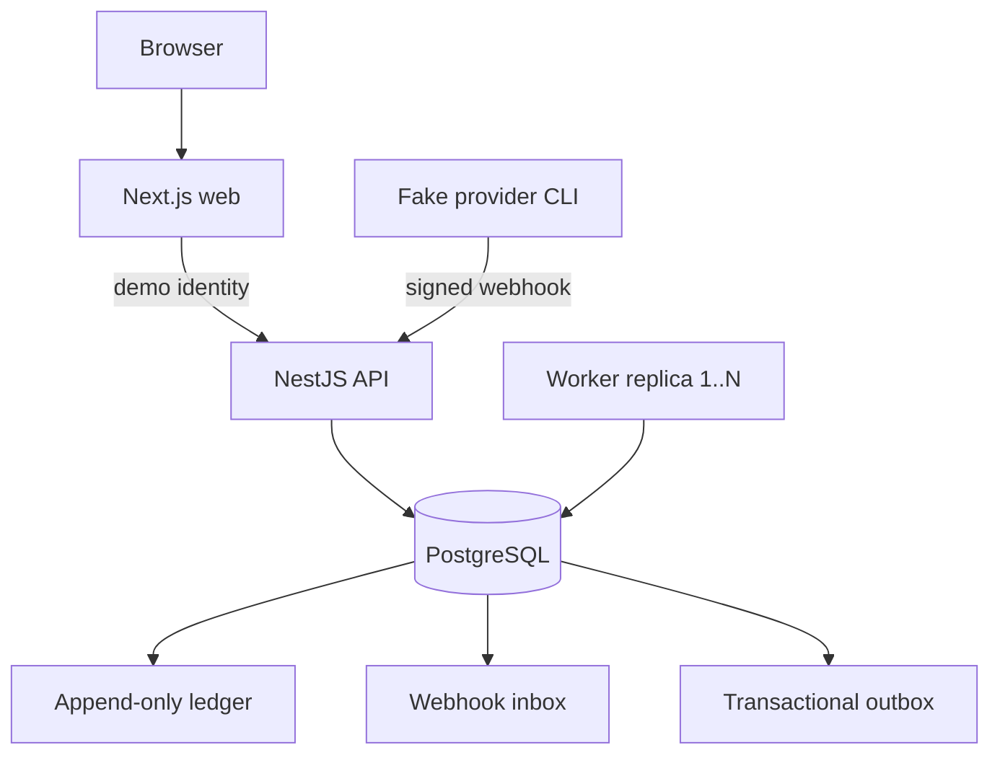

# Design and architecture

This document describes the correctness boundaries and major trade-offs of the Mentor Booking assignment. The system is intentionally small, but its financial and scheduling invariants are enforced at the database boundary rather than trusted to one process.

## System shape

The Next.js application is both UI and a thin backend-for-frontend. Server components/actions read an HTTP-only demo identity cookie and call the NestJS API. Nest owns validation, authorization, domain policy, and transactions. PostgreSQL 17 stores application state, coordinates concurrent API/worker instances, and supplies the authoritative clock. A separate worker polls the database for lifecycle, expiry, reminder, and outbox work. The fake provider CLI signs exact webhook bytes with HMAC-SHA256.

Compose runs migrations as a one-shot privileged service before the restricted API/worker login starts. The [complete ERD](erd.md) shows tables, ownership, and audit links.

## Data model and accounting

`users` owns role and IANA timezone; `mentor_profiles` makes mentor-only foreign keys enforceable. Availability is recurring mentor-local weekday/time. Blockouts and sessions are absolute `timestamptz` ranges. PostgreSQL checks valid timezone names, positive ranges, role-correct ownership, fixed 30-minute sessions, and consistent cancellation metadata.

Credits have three layers: `credit_lots` records origin/type/quantity/expiry; append-only `ledger_entries` records each signed movement and source; `session_credit_allocations` identifies the exact lot consumed by a booking. Balances are derived by summing the ledger, excluding expired rollover availability, including signed debt, and clamping spendable credit at zero. A trigger rejects ledger mutation. This costs more joins than a balance column, but preserves a complete explanation and avoids balance/history drift.

Spend order is unexpired rollover by earliest expiry, then normal, with stable creation/ID ordering. A refund returns the allocation to its original lot while valid. If rollover has expired, cancellation creates a new normal lot rather than reviving it. Expiry journals only remaining credit; booked allocation stays valid.

## Preventing double-booking and overspending

Booking uses one `READ COMMITTED` transaction and a global lock order: mentee `users` row `FOR UPDATE`, mentor profile `FOR UPDATE`, then session when changing an existing session. After locks, it reads `clock_timestamp()` and revalidates alignment, availability, blockouts, conflicts, and credit. Session, allocation, debit, and optional idempotency row commit atomically.

The mentee lock serializes credit writers; the mentor lock serializes booking and schedule edits. Partial GiST exclusion constraints over half-open ranges independently reject overlapping active mentor or mentee sessions. Unique ledger/request keys guard retries. Deadlock/serialization retries are bounded.

For two requests competing for the last credit, both target the same mentee row. One obtains the lock, debits and commits; the other then acquires the lock, recomputes the ledger balance, and returns `INSUFFICIENT_CREDITS`. For two mentees competing for one slot, the mentor lock orders them; the loser observes the committed session and returns `SLOT_UNAVAILABLE`. The GiST constraints remain the last guard if a future write path omits those checks. These cases are exercised by `apps/api/test/booking.integration.mjs`.

Rejected alternatives:

- Application-only availability checks have a time-of-check/time-of-use race.
- A mutable balance cannot explain allocation, expiry, refund, reversal, or debt.
- `SERIALIZABLE` everywhere still requires retries and does not replace range constraints; targeted locks make contention explicit.
- A distributed lock adds a failure domain while contested state already lives in PostgreSQL.

## Timezones and DST

Weekly rules store ISO weekday and wall-clock times in the mentor's IANA timezone; sessions/blockouts store instants. Slot generation enumerates `:00`/`:30` labels, resolves each with Luxon, and round-trips it: spring-gap labels are skipped, an autumn fold produces one documented occurrence (earlier UTC), ends remain 30 elapsed minutes after starts, and intervals are half-open.

Examples covered by tests: London `2026-03-29 01:00/01:30` do not exist and are omitted; London `2026-10-25 01:30` is ambiguous and the earlier UTC occurrence is emitted once. A Kolkata Monday `09:00` slot is Sunday `19:30` for a Los Angeles viewer on the tested winter date, so the viewer's calendar day legitimately differs. Offsets are obtained from IANA rules, never hardcoded.

The API returns UTC and viewer-local forms. Booking reuses the offered-start policy inside its transaction, so preview never reserves. Lifecycle uses elapsed UTC milliseconds: join opens five minutes before start, resolution is due five minutes after end, and no-show rollover expires 30 elapsed days after award.

## Cancellation and lifecycle

Mentee cancellation refunds only when `now < starts_at - 24 hours`; exactly the boundary yields zero. It closes at official start even if the worker is late. UI confirmation submits the previewed outcome; the locked transaction recomputes it and reports a policy conflict if it changed.

Mentor cancellation accepts scheduled/in-progress sessions and atomically stores cancellation, full refund, and outbox event. Lifecycle transitions are monotonic and join timestamps are first-write-wins. Due work uses `SKIP LOCKED`; attendance resolves to completed or one no-show state. Mentor no-show atomically grants a 30-day rollover. Cancellation/resolution share locks and recheck state, preventing double compensation.

## Payment idempotency and recovery

Purchase initiation creates `PENDING`; only signed webhooks change financial state. The API verifies HMAC over exact raw bytes, then durably inserts `payment_events` before processing. Provider event IDs are unique and conflicting bytes are rejected. Processing locks inbox, payment, then mentee and commits status/lot/ledger together.

Business keys prevent duplicate grants even across different event IDs. Success grants once. Refund-first is terminal; refund-after-success reverses unused credit and records consumed value as debt. A crash after receipt is resumed by redelivery or the recovery command. Invalid signatures are never stored. This avoids both mark-before-accounting loss and an unrecoverable all-or-nothing request.

## Worker and outbox

The worker is PostgreSQL-backed because jobs already require database transactions. Replicas claim bounded work with `SKIP LOCKED`; unique keys and status predicates make retries safe. Reminder creation shares locks with cancellation.

Dispatch records `notification_deliveries` and marks the event processed in one transaction: exactly-once for the included database adapter. A real external call is at-least-once because it may succeed before local commit; production would pass `event_key` to an idempotent provider. Failures back off and park after eight attempts.

## Security boundaries

Demo auth is gated by `DEMO_AUTH_ENABLED`. The API reloads role from PostgreSQL, but a seeded UUID is not identity proof. There is no password, session rotation, CSRF token, or rate limiting, so this is trusted-local only. The signing secret stays server-side, SQL is parameterized, bios render as text, and migration/runtime database privileges are separate.

Production work would add OIDC-backed sessions, CSRF/throttling, managed secret rotation, restricted ingress, centralized privileged-action auditing, and dependency/container scanning in CI.

## Verification and gaps

Unit tests cover policy and DST logic. Integration suites use real temporary PostgreSQL databases and concurrent requests for same slot/last credit, plus constraints, rollback, webhook replay/order/recovery, expiry/cancellation races, lifecycle, workers, and authorization. Chromium E2E exercises user journeys. A mutation removing the mentee lock made the last-credit test fail. See [system-tests.md](system-tests.md).

Known gaps: fixed 30-minute/one-credit sessions and one pack; purchase initiation lacks a client idempotency key; no production identity/payment/video/notification integration or outbox operations UI; no maximum booking horizon; polling lacks production metrics/capacity evidence; Chromium-only E2E. Another week would prioritize identity/HTTP hardening, provider contracts, observability/dead-letter operations, configurable products, load/chaos testing, then broader browser and accessibility verification.
