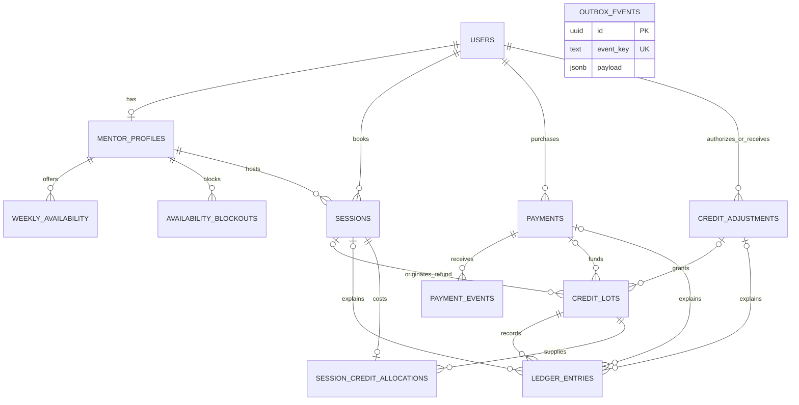

# PostgreSQL domain model

### Booking and time

Recurring availability uses ISO weekday and local wall-clock times. A mentor's timezone comes from their user record. PostgreSQL validates zone names against its installed timezone database. Blockouts and sessions use absolute instants. The booking service will validate half-hour alignment in the mentor's local calendar and recheck availability under a mentor lock.

Two partial GiST exclusion constraints reject intersecting non-cancelled intervals for the same mentor or mentee, including writes on different connections. The second writer waits for an uncommitted conflict and fails with SQLSTATE `23P01` if the first commits. Half-open intervals allow adjacent sessions. Cancelling removes the interval from both indexes while retaining the historical row. A unique start time alone would miss partially overlapping intervals.

### Credits and audit

Each credit lot identifies one funding source by a typed foreign key to a payment, session or admin adjustment. Composite foreign keys ensure financial references belong to the same mentee. Generated role columns constrain the roles of mentors, mentees and administrators. Each MVP booking can allocate one unit from one lot. That allocation preserves the original source for a refund even when the source has expired.

The wallet sums signed ledger deltas by lot at the requested instant. Rollover lots have an expiry instant and are consumed earliest-expiry first to preserve expiring value. Spending records the debit immediately, so expiry affects only the remaining quantity. The booking service must acquire the mentee row lock before checking funds, then commit the session, allocation and debit together. Exclusion constraints alone do not serialize two different non-overlapping bookings competing for a final credit.

Ledger corrections use compensating inserts. Runtime grants permit only SELECT and INSERT on the ledger, lots, allocations and adjustment requests. A statement trigger also rejects ledger UPDATE, DELETE and TRUNCATE by privileged ordinary writes. Database administrators control DDL and maintenance. Domain records use restrictive foreign keys to preserve audit references.

### Retry boundaries

Unique provider identifiers protect payment and event identity. The inbox stores signed payload bytes, receipt and processing metadata. A unique adjustment request can span multiple per-lot ledger entries. Ledger idempotency keys, outbox event keys and the partial pending-outbox index support later transactional handlers and workers. Outbox payloads carry event-specific references. Payment reconciliation, job execution and wallet policy are implemented in their respective stories.

### Wallet reads and appends

`LedgerService.appendEntry(tx, input)` requires a checked-out pg client inside an active transaction. The caller owns BEGIN, COMMIT and ROLLBACK. Use READ COMMITTED and acquire `lockMentee(tx, menteeId)` before any funds decision or mentor lock. Append takes the same transaction-scoped row lock. The database checks lot ownership and references and arbitrates the global idempotency key. An identical retry returns the first persisted row, including its original timestamp. A different amount, kind, owner, lot, source or reason conflicts. A failed enclosing operation rolls back the append together with other changes.

Wallet totals and the first history page use one read-only repeatable-read snapshot. The default cutoff is the PostgreSQL transaction clock; an internal `asOf` can reproduce a historical cutoff. Positive normal lot remainders and unexpired rollover remainders are reported separately. A rollover stops contributing at its exact expiry. Negative lot remainders are shown as signed debt; spendable credit is the positive portion of normal plus rollover plus debt. This accounts for reversals and compensations through net lot balances.

History orders by database timestamp and UUID descending. A cursor identifies its immutable anchor in the current user's ledger; PostgreSQL compares both columns at native precision. Newer inserts appear on refresh. Separate page requests read the current committed history. Expiry and cancellation never erase earlier movements.

### Fake payment confirmation

The authenticated mentee orders the four-credit MVP pack. PostgreSQL holds the pending quantity and purchaser. The webhook authenticates its sender with a constant-time HMAC-SHA256 comparison over the original, uncompressed request bytes before JSON decoding. The provider payment identifier resolves the order. A signed pack quantity must match the stored quantity when supplied.

### Durable receipt and financial processing

Migration 0003 adds an attempt counter and a partial index for pending receipts. The runtime can update processing metadata only. The first autocommit statement stores the signed body, provider event and payment IDs, type and receipt time after order and quantity validation. The provider timestamp is preserved in the signed body. PostgreSQL's unique provider event ID serializes competing inserts. Reuse requires byte-for-byte equality, including whitespace. An invalid signature cannot create a receipt.

A second transaction locks the inbox row, then the payment, then the mentee when an accounting effect is required. The transaction commits new lot/ledger entries, the terminal or successful payment transition, and the processed timestamp together. An HTTP acknowledgment follows commit. A processed receipt bypasses financial effects. For a fresh receipt, the payment lock, terminal state and unique ledger keys protect business effects across different event IDs.

| Current state | Success | Refund |
|---|---|---|
| PENDING | Grant once and become SUCCEEDED; a known pending refund takes precedence | Become REFUNDED with zero grants |
| SUCCEEDED | Acknowledge existing entitlement | Reverse the original grant and become REFUNDED |
| REFUNDED | Acknowledge terminal state | Acknowledge terminal state |

Under the mentee lock, sum all deltas on the lot identified by the original purchase grant. Reverse the positive remainder up to the grant quantity; record the rest as DEBT against that same lot. Skip zero-value entries. The keys `purchase-reversal:<paymentId>` and `purchase-debt:<paymentId>` identify the compensations. Existing US-08 grants use the same purchase-grant key and can be refunded after upgrade. The wallet already nets negative lot balances against spendable funds.

Before receipt commit a provider retry is required. After receipt commit a pending row is discoverable, even if processing never started. An exception before financial commit rolls back all effects. A separate conditional metadata update records a sanitized error only while still pending. Attempts count completed processing or recorded failures; a hard termination can leave the counter unchanged. Serialization failures and deadlocks get at most three transaction attempts per invocation. Redelivery or the bounded recovery command can resume pending work after restart. If a response is lost after commit, the next delivery observes the processed marker.

### Rollover selection and expiry

US-11 calls `RolloverService.selectSpendableLot(tx, menteeId)` inside its READ COMMITTED booking transaction. Acquire the mentee lock before any mentor lock; selection can reacquire the same lock. Check the selected lot immediately before recording the debit. PostgreSQL evaluates the current statement time after the lock wait. An optional trusted clock argument supports deterministic tests. Selection reads every committed movement under the lock, including outstanding debt. It returns null when net spendable credit is below one. Selection alone reserves nothing: keep the lock through the debit, allocation, session insert and commit.

PostgreSQL orders eligible lots by expiry (normal lots last), creation time and UUID. Spending the earliest expiring credit preserves the mentee's usable credit for longer. At the exact expiry instant the wallet and selection both exclude the positive remainder. The expiry pass discovers due owners, then rereads net lot quantities inside one locked transaction per owner. Each positive remainder gets a signed compensating entry with key `rollover-expire:<lotId>`. The journal timestamp is at or after expiry even when a transaction waited for a lock. A failed owner's writes roll back together; another pass safely resumes. A fully consumed lot needs no expiry entry.

The allocation continues to identify the original funding lot after expiration. For a future full session refund, return the credit to its original rollover lot with its original expiry while valid. After expiry issue a new normal refund lot. A mentor no-show will instead originate a new rollover lot expiring exactly 30 days after resolution. US-15 can schedule the existing one-shot expiry pass; wallet correctness is independent of that schedule.

### Slot preview

Weekly rules are interpreted in the mentor's current IANA zone. The generator enumerates :00 and :30 labels on each requested mentor date, resolves each label with Luxon, and skips any label that fails to round-trip through the zone. During the London spring gap on 2026-03-29 this skips 01:00 and 01:30. During the autumn fold on 2026-10-25 it picks the earlier UTC instant once per local start label (01:30 BST is 00:30Z). Ends are always 30 elapsed minutes after starts. A fall-back slot can therefore end at an earlier displayed clock time with a different offset.

Each half-open slot [start, end) must fit entirely inside one active weekly rule. If the UTC offset changes inside the interval, each constant-offset segment must fit. The read-only repeatable-read snapshot filters starts strictly after the database clock at snapshot transaction start and removes intersections with mentor blockouts or any non-cancelled mentor session. PostgreSQL compares absolute instants with full stored precision. A blockout ending at the slot start leaves the slot available. Results are sorted by UTC start and include viewer-local ISO values with offsets.

US-11 must acquire the mentee and mentor locks in the project's order and revalidate the selected UTC instant, current availability, blockouts, session conflicts and credit inside its booking transaction. A successful preview does not reserve time.

### Atomic booking (US-11)

`POST /sessions` runs one READ COMMITTED transaction per attempt:

1. Lock the mentee row (`LedgerService.lockMentee`, `FOR UPDATE`).
2. If an `Idempotency-Key` is present, look it up in `booking_requests` and replay or reject.
3. Lock the mentor profile row (`FOR UPDATE`) and read the mentor's current timezone.
4. Check alignment on the mentor's wall clock, then read the authoritative clock (`clock_timestamp()`) after both locks are held.
5. Recheck the start against active weekly rules with `isOfferedStart`, which reuses the US-06 generator, then check half-open blockouts, the mentor's non-cancelled sessions and the mentee's non-cancelled sessions.
6. Select a lot with `RolloverService.selectSpendableLot` at that clock: rollover by earliest expiry, then normal, with outstanding debt counted.
7. Insert the session, its allocation, the `BOOKING_DEBIT` (-1, key `booking-debit:<sessionId>`) and the idempotency row, then commit.

Any error rolls back all of them, so a session never exists without its allocation and debit, and a debit never exists without its session.

Lock order is always mentee, then mentor. Schedule edits lock only the mentor; payment processing locks inbox, payment, then mentee; no path locks a mentor before a mentee, so there is no lock cycle. The mentee lock serializes spending, so two bookings cannot both take the last credit. The mentor lock serializes bookings against each other and against availability or blockout edits, so a booking either sees a committed blockout and fails, or commits first and makes the blockout edit fail with `BLOCKOUT_CONFLICT`. Inserting a session also takes FK `KEY SHARE` locks on the mentor profile and mentee rows, which conflict with these `FOR UPDATE` locks, so even a writer that skips the application locks is ordered before or after a booking rather than interleaved with it. The partial GiST exclusion constraints stay the final guard: a `23P01` on `sessions_mentor_overlap` maps to `SLOT_UNAVAILABLE` and on `sessions_mentee_overlap` to `SESSION_OVERLAP`, after a full rollback. Deadlock and serialization failures get at most three attempts; the tests assert that the documented order needs exactly one.

Booking accepts exactly the instants the preview offers. In the spring gap no local label maps to a missing time. In the autumn fold only the earlier occurrence of a repeated label is bookable (01:30 BST, not 01:30 GMT), and the preview never shows the later one. The weekday is the mentor's local weekday even when the UTC date differs. Alignment is to :00/:30 of the mentor's clock, which matters for +05:45 zones.

`booking_requests (mentee_id, idempotency_key) PRIMARY KEY` references the session, so a key exists only for a committed booking. Concurrent retries are serialized by the mentee lock; the second sees the committed row and replays it. The request fingerprint is the referenced session's mentor and start. The allocation keeps the exact funding lot, which US-12 needs for refunds.

Known limitations: one credit and 30 minutes per session; no maximum booking horizon (the specification defines none; only a preview request is limited to 31 days); no booking confirmation or reminder notifications yet (US-15 will scan scheduled sessions); a replay reports the session's current status rather than a stored response snapshot.

### Mentee cancellation (US-12)

`menteeCancellationPolicy` is a pure function of status, official start and the server clock. A refund requires `startsAt - now > 24h` (`now < cutoffAt`); exactly 24 hours refunds nothing. Cancellation closes at the official start regardless of the stored status, so a delayed lifecycle worker cannot reopen it; early-join timestamps are ignored. Mentor cancellation (US-13) will use its own always-refund policy.

The preview reads the session and `clock_timestamp()` without locks. Confirmation carries `expectedRefundableCredits`. The cancel transaction locks the mentee row, then the mentor profile row (the US-11 order), then the session row `FOR UPDATE`, and only then reads the clock and recomputes the policy. If the outcome differs from the confirmed one in either direction, it returns 409 `CANCELLATION_POLICY_CHANGED` with the current preview before any write. Otherwise it sets `status='cancelled'`, `cancelled_at` and `cancellation_actor`, and, if refundable, appends one `CANCELLATION_REFUND` (+1, key `cancel-refund:<sessionId>`) in the same transaction. Any error rolls back both. A session already `cancelled` under the lock yields a stable 200 no-op reporting the recorded refund, which makes retries and concurrent requests safe; the unique ledger key is the second guard.

`refundAllocatedCredit` (shared with US-13) refunds the lot named by the session's allocation: the original normal lot, or the original rollover lot with its expiry unchanged while `expires_at > now`. If that rollover lot has expired, it issues a new NORMAL lot with `session_id` as its source and credits it, so the expired lot is never revived and the allocation remains the audit trail. Migration 0005 adds a partial unique index allowing at most one such normal lot per session.

Lock order for later stories: mentee, mentor, session. A worker (US-15) that claims sessions with `SKIP LOCKED` and must change credit (no-show rollover) should take the mentee lock before locking the session row inside its transaction.

### Mentor cancellation and admin adjustments (US-13)

`mentorCancellationDecision` has no clock input: `scheduled` and `in_progress` cancel, a mentor-cancelled session replays, and every other outcome (completed, no-shows, mentee cancellation) is a 409. The transaction takes the shared lock order (mentee, mentor profile, session row), rechecks the status, sets `cancelled`, `cancelled_at` and the mentor as `cancellation_actor`, calls `refundAllocatedCredit` with `MENTOR_REFUND` and key `mentor-refund:<sessionId>`, and inserts outbox event `mentor-cancelled:<sessionId>` (type `MENTOR_CANCELLED`, payload with `recipientId` = mentee, session, mentor, start, refund and reason; `processed_at` NULL). These commit or roll back together, and the unique ledger and outbox keys are second guards against duplicates. Mentor and mentee cancellations race on the same locks; the loser sees the committed terminal state. A worker transition to `in_progress` holding the session row is waited for and stays cancellable; a terminal transition is rejected. US-15 delivers outbox rows and marks them processed.

Admin adjustments lock the target mentee like every other credit writer and record one `credit_adjustments` row (unique `idempotency_key`, acting admin, reason, delta). Grants fund a NORMAL lot linked to the adjustment. Revokes are capped at the derived spendable credit and split across lots in spend order with per-lot keys `admin-adjustment:<adjustmentId>:<lotId>`, so they never deepen debt. Identical retries replay the receipt; other reuse of a key is a conflict.

### Session lifecycle and attendance (US-14)

`lifecycle-policy.ts` defines the state machine: `scheduled → in_progress | cancelled | completed | no_show_*` (resolution may skip `in_progress` if the start tick was missed), `in_progress → completed | no_show_* | cancelled`, and no exits from terminal states. All timing is elapsed UTC milliseconds, so DST changes never alter windows: join opens at `starts_at − 5 min` and closes at `ends_at`; resolution is due at `ends_at + 5 min`; a no-show rollover expires 720 hours after the award.

- **Join** locks only the session row (it never changes credit and never waits for another lock while holding it), reads the clock under the lock, starts a due `scheduled` session if the official start has passed, and sets the caller's column with `COALESCE`, so the first timestamp is kept.
- **Start** (`startDue`) is one `UPDATE … WHERE id IN (SELECT … status='scheduled' AND starts_at <= now … FOR UPDATE SKIP LOCKED) AND status='scheduled'`: never early, never twice, and rows held by a cancellation are skipped rather than waited for or overwritten.
- **Resolution** (`resolveSession`) takes the shared credit order (mentee lock, then session row), rechecks that the session is still `scheduled`/`in_progress` and due, classifies attendance (B4; nobody joined is a mentee no-show), and for `no_show_mentor` inserts a new ROLLOVER lot with `session_id` and appends `NO_SHOW_ROLLOVER` (+1, key `mentor-no-show:<sessionId>`) in the same transaction. The booking debit is never touched. Because mentor cancellation and resolution serialize on the mentee lock and each rechecks the status, a session ends with either `MENTOR_REFUND` or `NO_SHOW_ROLLOVER`, never both. Concurrent resolvers block on the mentee lock and the losers find a terminal status.

US-15 contract: call `startDue({now, limit})` and `resolveDue({now, limit})` on each tick (both are safe to run concurrently and repeatedly) and `expireRolloverLots`. Completion and no-show produce no outbox events, since the specification requires notifications only for reminders and mentor cancellations.

### Background worker and outbox delivery (US-15)

A DB-backed polling worker rather than a queue product: every job is already a PostgreSQL transaction, so coordination lives in row locks and unique keys and no broker is needed. It runs as its own Compose service (same image, separate process); any number of replicas may run. A tick calls `LifecycleService.startDue` and `resolveDue`, `RolloverService.expireRolloverLots`, `ReminderService.queueDue` and `OutboxDispatcher.dispatch`, each bounded by the batch size and isolated so that one failing job is logged and retried next tick without stopping the others. `resolveDue` was hardened to continue past a session whose resolution fails, because candidates are ordered by end time and one poison session would otherwise block every later one. The loop waits the poll interval after each tick, so ticks never overlap; SIGTERM lets the running tick finish.

Reminders are one `INSERT … SELECT` over still-`scheduled` sessions with `starts_at − 1 hour <= now < starts_at` and no existing reminder, locking candidates `FOR SHARE SKIP LOCKED`: a session held by an in-flight cancellation or join is skipped and re-evaluated next tick, so a cancelled session is never newly queued. `ON CONFLICT (event_key) DO NOTHING` makes concurrent ticks harmless. The window (rather than an exact instant) covers late bookings and worker downtime. One hour is elapsed time on UTC instants, so DST is irrelevant.

Dispatch claims one due event at a time (`processed_at IS NULL AND available_at <= now … FOR UPDATE SKIP LOCKED`). In the same transaction it rechecks a reminder's session (`FOR SHARE`; not scheduled or already started means `SUPPRESSED`), inserts the delivery row (unique `outbox_event_id` and `event_key`), logs it, and sets `processed_at`, `outcome` and `attempts`. A crash at any point before commit rolls everything back and releases the lock, so the event is simply pending again; nothing can stay claimed. A recorded delivery is therefore exactly-once. With a real provider the call would sit between claim and commit and be at-least-once, using `event_key` as the provider's idempotency key. A failure is recorded after the rollback: `attempts` is incremented, `last_error` set and `available_at` pushed back (5 s × 2ⁿ, at most 5 min); after 8 attempts the row is parked as `FAILED` and logged as an error.

Known limitations: a tick is sequential, so throughput scales by adding workers; there is no health endpoint, so liveness comes from container restarts and the logs; parked `FAILED` events need manual re-queueing (`UPDATE outbox_events SET processed_at=NULL, outcome=NULL, available_at=now()` as a privileged user).

### Web UI and design system (US-04)

**References.** The layout follows the conventions of the Shadboard admin template (dark fixed sidebar, slim top bar, card-based content, breadcrumbs) and, selectively, OrbynAdmin (simple overview cards for the mentor and admin workspaces). No code from either was copied; their repositories were mostly unreachable from the build environment, so they served as visual inspiration only. The primitives in `apps/web/components/ui` (button, card, badge, input, sheet, dropdown menu, skeleton) are adapted from [shadcn/ui](https://ui.shadcn.com) (MIT) on top of `radix-ui` and are marked as such.

**Tokens.** `app/globals.css` defines semantic CSS variables on `:root` and `.dark` (background, foreground, card, primary indigo, muted, border, success, warning, destructive with soft variants, sidebar, shadows, radii) and maps them to Tailwind v4 colours with `@theme inline`. Components use only these names (`bg-card`, `text-muted-foreground`), so a theme change is a token change. The main text pairs were checked for WCAG AA contrast (muted text is 4.55:1 on the light canvas, primary on white 6.3:1); focus rings are always visible, and motion is reduced under `prefers-reduced-motion`.

**Shell.** `(app)/layout.tsx` loads the current user from `/me` and wraps every signed-in page in `AppShell`: a skip link, the role-aware sidebar, the header (mobile drawer trigger, collapse toggle, viewer timezone, theme toggle, account menu) and a `max-w-6xl` main area. Navigation is data in `lib/navigation.ts`: each item has a role, route, icon and status. `ready` items are links with `aria-current`; `upcoming` items render as disabled entries with a "Soon" pill so the product shape is visible without dead links.

**Data and states.** Pages are server components that call the API with `lib/api.ts` (no cache, 5 s timeout, errors normalized to `ApiError`). Every data view has a skeleton (`loading.tsx`), an empty state, a distinct "no results" state, a not-found page and an error state that distinguishes 403, an unreachable API and other failures and offers a retry. Mentor bios are rendered as plain text (no HTML), and cards show only fields the API returns: no ratings, prices or credentials are invented. Pure helpers (`lib/format.ts`) cover initials, timezone labels, URL state and view selection and are unit-tested.

**Extension points.**
- US-16 (booking UI): replace the disabled "Book a session" button in the profile's booking panel; the openings list already calls the slots API and formats times in the viewer's zone. Mark "My sessions" as `ready` in `lib/navigation.ts`.
- US-17 (wallet UI): reuse `Card`, `Badge` (`success`, `warning`, `destructive` for lot and expiry states) and the tokens; "My wallet" and "History" are already in the mentee navigation.
- US-18 (mentor and admin views): build on `PageHeader`, `Card`, `EmptyState`, `ApiErrorState` and replace `WorkspaceOverview` on `/mentor` and `/admin`.

**Known limitations.** Demo authentication is a cookie holding a seeded user ID, not real sign-in. The directory is not paginated (sized for the seed). Timezone offset labels come from the platform's time zone data.
