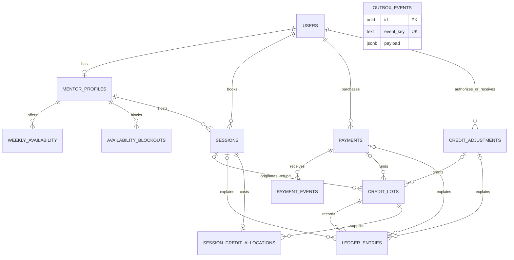

# PostgreSQL domain model

### Booking and time

Recurring availability uses ISO weekday and local wall-clock times. A mentor's timezone comes from their user record. PostgreSQL validates zone names against its installed timezone database. Blockouts and sessions use absolute instants. The booking service will validate half-hour alignment in the mentor's local calendar and recheck availability under a mentor lock.

Two partial GiST exclusion constraints reject intersecting non-cancelled intervals for the same mentor or mentee, including writes on different connections. The second writer waits for an uncommitted conflict and fails with SQLSTATE `23P01` if the first commits. Half-open intervals allow adjacent sessions. Cancelling removes the interval from both indexes while retaining the historical row. A unique start time alone would miss partially overlapping intervals.

### Credits and audit

Each credit lot identifies one funding source by a typed foreign key to a payment, session or admin adjustment. Composite foreign keys ensure financial references belong to the same mentee. Generated role columns constrain the roles of mentors, mentees and administrators. Each MVP booking can allocate one unit from one lot. That allocation preserves the original source for a refund even when the source has expired.

The wallet sums signed ledger deltas by lot at the requested instant. Rollover lots have an expiry instant and are consumed earliest-expiry first to preserve expiring value. Spending records the debit immediately, so expiry affects only the remaining quantity. The booking service must acquire the mentee row lock before checking funds, then commit the session, allocation and debit together. Exclusion constraints alone do not serialize two different non-overlapping bookings competing for a final credit.

Ledger corrections use compensating inserts. Runtime grants permit only SELECT and INSERT on the ledger, lots, allocations and adjustment requests. A statement trigger also rejects ledger UPDATE, DELETE and TRUNCATE by privileged ordinary writes. Database administrators control DDL and maintenance. Domain records use restrictive foreign keys to preserve audit references.

### Retry boundaries

Unique provider identifiers protect payment and event identity. The inbox stores signed payload bytes, receipt and processing metadata. A unique adjustment request can span multiple per-lot ledger entries. Ledger idempotency keys, outbox event keys and the partial pending-outbox index support later transactional handlers and workers. Outbox payloads carry event-specific references. Payment reconciliation, job execution and wallet policy are implemented in their respective stories.

### Wallet reads and appends

`LedgerService.appendEntry(tx, input)` requires a checked-out pg client inside an active transaction. The caller owns BEGIN, COMMIT and ROLLBACK. Use READ COMMITTED and acquire `lockMentee(tx, menteeId)` before any funds decision or mentor lock. Append takes the same transaction-scoped row lock. The database checks lot ownership and references and arbitrates the global idempotency key. An identical retry returns the first persisted row, including its original timestamp. A different amount, kind, owner, lot, source or reason conflicts. A failed enclosing operation rolls back the append together with other changes.

Wallet totals and the first history page use one read-only repeatable-read snapshot. The default cutoff is the PostgreSQL transaction clock; an internal `asOf` can reproduce a historical cutoff. Positive normal lot remainders and unexpired rollover remainders are reported separately. A rollover stops contributing at its exact expiry. Negative lot remainders are shown as signed debt; spendable credit is the positive portion of normal plus rollover plus debt. This accounts for reversals and compensations through net lot balances.

History orders by database timestamp and UUID descending. A cursor identifies its immutable anchor in the current user's ledger; PostgreSQL compares both columns at native precision. Newer inserts appear on refresh. Separate page requests read the current committed history. Expiry and cancellation never erase earlier movements.

### Fake payment confirmation

The authenticated mentee orders the four-credit MVP pack. PostgreSQL holds the pending quantity and purchaser. The webhook authenticates its sender with a constant-time HMAC-SHA256 comparison over the original, uncompressed request bytes before JSON decoding. The provider payment identifier resolves the order. A signed pack quantity must match the stored quantity when supplied.

### Durable receipt and financial processing

Migration 0003 adds an attempt counter and a partial index for pending receipts. The runtime can update processing metadata only. The first autocommit statement stores the signed body, provider event and payment IDs, type and receipt time after order and quantity validation. The provider timestamp is preserved in the signed body. PostgreSQL's unique provider event ID serializes competing inserts. Reuse requires byte-for-byte equality, including whitespace. An invalid signature cannot create a receipt.

A second transaction locks the inbox row, then the payment, then the mentee when an accounting effect is required. The transaction commits new lot/ledger entries, the terminal or successful payment transition, and the processed timestamp together. An HTTP acknowledgment follows commit. A processed receipt bypasses financial effects. For a fresh receipt, the payment lock, terminal state and unique ledger keys protect business effects across different event IDs.

| Current state | Success | Refund |
|---|---|---|
| PENDING | Grant once and become SUCCEEDED; a known pending refund takes precedence | Become REFUNDED with zero grants |
| SUCCEEDED | Acknowledge existing entitlement | Reverse the original grant and become REFUNDED |
| REFUNDED | Acknowledge terminal state | Acknowledge terminal state |

Under the mentee lock, sum all deltas on the lot identified by the original purchase grant. Reverse the positive remainder up to the grant quantity; record the rest as DEBT against that same lot. Skip zero-value entries. The keys `purchase-reversal:<paymentId>` and `purchase-debt:<paymentId>` identify the compensations. Existing US-08 grants use the same purchase-grant key and can be refunded after upgrade. The wallet already nets negative lot balances against spendable funds.

Before receipt commit a provider retry is required. After receipt commit a pending row is discoverable, even if processing never started. An exception before financial commit rolls back all effects. A separate conditional metadata update records a sanitized error only while still pending. Attempts count completed processing or recorded failures; a hard termination can leave the counter unchanged. Serialization failures and deadlocks get at most three transaction attempts per invocation. Redelivery or the bounded recovery command can resume pending work after restart. If a response is lost after commit, the next delivery observes the processed marker.

### Rollover selection and expiry

US-11 calls `RolloverService.selectSpendableLot(tx, menteeId)` inside its READ COMMITTED booking transaction. Acquire the mentee lock before any mentor lock; selection can reacquire the same lock. Check the selected lot immediately before recording the debit. PostgreSQL evaluates the current statement time after the lock wait. An optional trusted clock argument supports deterministic tests. Selection reads every committed movement under the lock, including outstanding debt. It returns null when net spendable credit is below one. Selection alone reserves nothing: keep the lock through the debit, allocation, session insert and commit.

PostgreSQL orders eligible lots by expiry (normal lots last), creation time and UUID. Spending the earliest expiring credit preserves the mentee's usable credit for longer. At the exact expiry instant the wallet and selection both exclude the positive remainder. The expiry pass discovers due owners, then rereads net lot quantities inside one locked transaction per owner. Each positive remainder gets a signed compensating entry with key `rollover-expire:<lotId>`. The journal timestamp is at or after expiry even when a transaction waited for a lock. A failed owner's writes roll back together; another pass safely resumes. A fully consumed lot needs no expiry entry.

The allocation continues to identify the original funding lot after expiration. For a future full session refund, return the credit to its original rollover lot with its original expiry while valid. After expiry issue a new normal refund lot. A mentor no-show will instead originate a new rollover lot expiring exactly 30 days after resolution. US-15 can schedule the existing one-shot expiry pass; wallet correctness is independent of that schedule.
