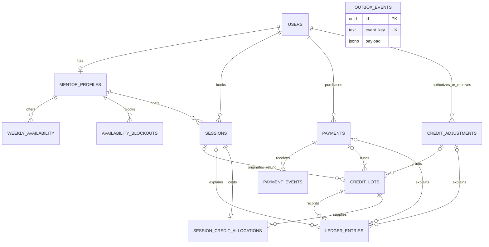

# PostgreSQL domain model

### Booking and time

Recurring availability uses ISO weekday and local wall-clock times. A mentor's timezone comes from their user record. PostgreSQL validates zone names against its installed timezone database. Blockouts and sessions use absolute instants. The booking service will validate half-hour alignment in the mentor's local calendar and recheck availability under a mentor lock.

Two partial GiST exclusion constraints reject intersecting non-cancelled intervals for the same mentor or mentee, including writes on different connections. The second writer waits for an uncommitted conflict and fails with SQLSTATE `23P01` if the first commits. Half-open intervals allow adjacent sessions. Cancelling removes the interval from both indexes while retaining the historical row. A unique start time alone would miss partially overlapping intervals.

### Credits and audit

Each credit lot identifies one funding source by a typed foreign key to a payment, session or admin adjustment. Composite foreign keys ensure financial references belong to the same mentee. Generated role columns constrain the roles of mentors, mentees and administrators. Each MVP booking can allocate one unit from one lot. That allocation preserves the original source for a refund even when the source has expired.

The wallet sums signed ledger deltas by lot at the requested instant. Rollover lots have an expiry instant and are consumed earliest-expiry first to preserve expiring value. Spending records the debit immediately, so expiry affects only the remaining quantity. The booking service must acquire the mentee row lock before checking funds, then commit the session, allocation and debit together. Exclusion constraints alone do not serialize two different non-overlapping bookings competing for a final credit.

Ledger corrections use compensating inserts. Runtime grants permit only SELECT and INSERT on the ledger, lots, allocations and adjustment requests. A statement trigger also rejects ledger UPDATE, DELETE and TRUNCATE by privileged ordinary writes. Database administrators control DDL and maintenance. Domain records use restrictive foreign keys to preserve audit references.

### Retry boundaries

Unique provider identifiers protect payment and event identity. The inbox stores signed payload bytes, receipt and processing metadata. A unique adjustment request can span multiple per-lot ledger entries. Ledger idempotency keys, outbox event keys and the partial pending-outbox index support later transactional handlers and workers. Outbox payloads carry event-specific references. Payment reconciliation, job execution and wallet policy are implemented in their respective stories.

### Wallet reads and appends

`LedgerService.appendEntry(tx, input)` requires a checked-out pg client inside an active transaction. The caller owns BEGIN, COMMIT and ROLLBACK. Use READ COMMITTED and acquire `lockMentee(tx, menteeId)` before any funds decision or mentor lock. Append takes the same transaction-scoped row lock. The database checks lot ownership and references and arbitrates the global idempotency key. An identical retry returns the first persisted row, including its original timestamp. A different amount, kind, owner, lot, source or reason conflicts. A failed enclosing operation rolls back the append together with other changes.

Wallet totals and the first history page use one read-only repeatable-read snapshot. The default cutoff is the PostgreSQL transaction clock; an internal `asOf` can reproduce a historical cutoff. Positive normal lot remainders and unexpired rollover remainders are reported separately. A rollover stops contributing at its exact expiry. Negative lot remainders are shown as signed debt; spendable credit is the positive portion of normal plus rollover plus debt. This accounts for reversals and compensations through net lot balances.

History orders by database timestamp and UUID descending. A cursor identifies its immutable anchor in the current user's ledger; PostgreSQL compares both columns at native precision. Newer inserts appear on refresh. Separate page requests read the current committed history. Expiry and cancellation never erase earlier movements.
