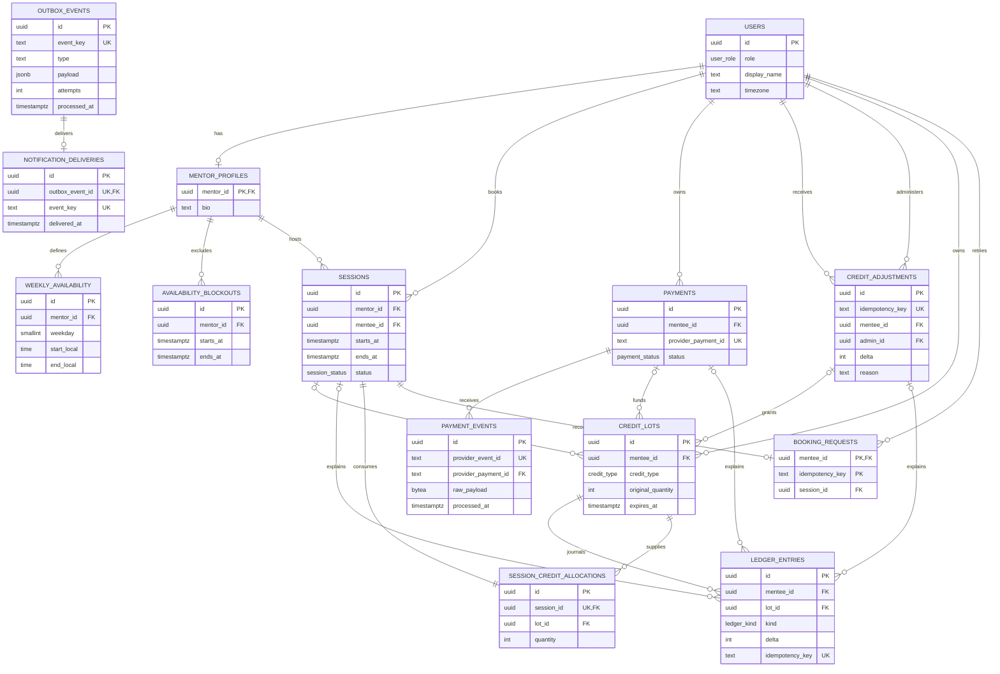

# Entity relationship diagram

## Important guarantees

- Partial GiST exclusion constraints reject overlapping active sessions for either mentor or mentee.
- Composite role foreign keys prevent using a user in the wrong domain role.
- A credit lot has exactly one source; rollover lots require an expiry and session source.
- Ledger kind/delta/source combinations are checked, and update/delete/truncate is rejected.
- Unique webhook, business, booking, ledger, and outbox keys make retries durable.
- Allocation preserves the exact funding lot required for deterministic refunds.
